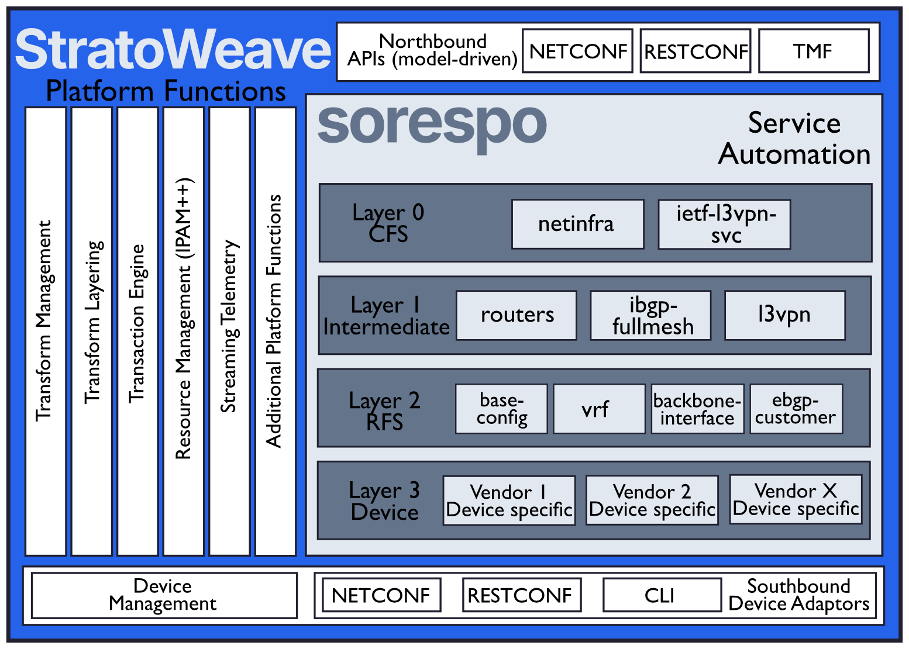

<p align="left">
  
</p>

**DORSI** is a reference implementation of a network automation system built
on [StratoWeave](https://github.com/stratoweave/stratoweave). It turns a short
description of a network into the configuration of every device and applies it.

Today it covers one domain: an **IP fabric for data centers** (3-stage and
5-stage Clos, on Nokia SR Linux).

> **Status: preliminary.** The IP fabric support is new. See
> [IP fabric: what is verified](#ip-fabric-what-is-verified) before relying on
> it.

## Introduction

While DORSI and StratoWeave are closely related, they are two distinct
projects with very different goals:
* **StratoWeave** is a ***platform*** for the development of robust network
orchestration systems based on model-driven declarative transforms. It does the
heavy lifting so you can focus on building automation that makes sense.
* **DORSI** is a **reference implementation** of a StratoWeave system. You
can use it to learn about network automation (development) or use it as a solid
foundation for your own network automation system design.

<p align="center">
  
</p>

DORSI was formerly known as SORESPO.

## Getting started

Head over to our [tutorials](https://www.stratoweave.org/tutorials) to get started with
running DORSI and/or making your first changes to the code in minutes!

The default `stable` branch works with the *stable* Acton release, while
development happens on `main`. See [development](docs/development.md) for how
the two branches relate and how to contribute.

To build and test from a checkout:

```sh
acton build
acton test
```

Use an Acton release that matches the StratoWeave version pinned in
`spec/Build.act`. CI builds `main` with the Acton *tip* release; the stable
release may not compile it yet. After changing a YANG model or the generator,
run `make gen` to regenerate `src/dorsi/layers/` and `src/dorsi/devices/`.

## Services

### IP fabric

The IP fabric service builds the **underlay** of a data center network as
described in [RFC 7938](https://www.rfc-editor.org/info/rfc7938/): routed
point-to-point links with eBGP on every link and ECMP across all equal paths.
The configuration follows the
[SR Linux fabric tutorial](https://learn.srlinux.dev/tutorials/l2evpn/fabric/).

The Customer Facing Service (CFS) model is `ip-fabric` (see
`spec/yang/cfs/ip-fabric.yang`). A `fabric` has:

| List | Describes |
| --- | --- |
| `switch` | A switch: `name`, `id`, `type`, `role` (`leaf`, `spine` or `super-spine`), and the `pod` and `plane` it belongs to |
| `fabric-link` | A routed link between two tiers: leaf to spine in the same pod, or spine to super-spine in the same plane |
| `server` | A server and how it connects: `single-homed` (one leaf) or `dual-homed` (two leaves), with its links to leaf ports |

You describe the switches, links and servers. DORSI derives everything else
from the switch `id`:

| What | Derived as |
| --- | --- |
| Loopback | `10.0.<id / 256>.<id % 256>` |
| Link addresses | one /31 from `10.100.0.0/16` per (lower switch, lower port) |
| AS number | private 4-byte: one per leaf, one per spine pod and plane, one per super-spine plane |

The addressing limits are a switch `id` up to 511 and a lower port number below
64. On SR Linux every switch gets a loopback, a BGP instance with ECMP, a policy
that advertises only the loopbacks, and for every link an interface with its /31
and an eBGP session. Server-facing leaf ports are enabled and described.

The fabric is validated before it is applied: tiers must be adjacent and in the
same pod or plane, a port may be used once, servers connect to leaves and match
their profile, and a five-stage fabric needs a super-spine and a spine in every
plane. An invalid fabric is rejected as a whole with every problem listed.

Out of scope for now: the **overlay** (EVPN/VXLAN). A dual-homed server has two
configured ports, but surviving the loss of a leaf needs an overlay.

#### IP fabric: what is verified

* The generated SR Linux configuration is covered by snapshot tests for a
  3-stage and a 5-stage topology (`src/dorsi/test_fabric.act`), and the
  validation by `src/dorsi/test_fabric_validation.act`.
* The 3-stage topology has been run on SR Linux 25.3.2 in
  [`test/fabric-3stage`](test/fabric-3stage/README.md): all eBGP sessions come
  up, ECMP and loopback reachability work.
* The 5-stage lab ([`test/fabric-5stage`](test/fabric-5stage/README.md)) has not
  been deployed: ten SR Linux nodes need much more memory than the 3-stage lab,
  which already needs about 9 GB.
* Not covered: server-to-server traffic, link and leaf failures, and live
  changes to a running fabric.

### Service automation layering

DORSI implements highly abstracted device and service configuration through
layers of automation. It uses two service layers, the Customer Facing Service
(CFS) and the Resource Facing Service (RFS), on top of the device layer.
StratoWeave does not place any limitations on the number of layers that can be
implemented, as few or many as necessary can be used.

```
                        +-------------------------------+
+-----------------------| RESTCONF Northbound Interface |-----------------------+
|                       +-------------------------------+                       |
|               +-----------------------------------------------+               |
|               |    Customer Facing Service (CFS) - Layer 0    |               |
|               +-----------------------------------------------+               |
|               +-----------------------------------------------+               |
|               |    Resource Facing Service (RFS) - Layer 1    |               |
|               +-----------------------------------------------+               |
|               +-----------------------------------------------+               |
|               |                Device - Layer 2               |               |
|               +-----------------------------------------------+               |
|                       +-------------------------------+                       |
+-----------------------|  NETCONF Southbound Interface |-----------------------+
                        +-------------------------------+
```

A *transform* turns the data of one layer into the data of the layer below. For
the fabric, the CFS transform `Fabric` (`src/dorsi/cfs.act`) derives the devices
and the RFS entries `fabric-base-config`, `fabric-interface` and `server-port`,
and the RFS transforms (`src/dorsi/rfs.act`) render them as device
configuration.

### Vendors

The service stack is designed to be vendor-neutral, but the IP fabric is
implemented for [Nokia SR Linux](https://www.nokia.com/ip-networks/service-router-linux-NOS/)
only. Device models for Cisco IOS XR and Juniper cRPD are generated as well
(`spec/yang/`), but no service uses them yet.

## Running it

* **Tests:** `acton test`.
* **With mocked devices**, without any containers: add `<mock>true</mock>` to
  every switch of a fabric file (for example `test/fabric-3stage/ip-fabric.xml`)
  and start `out/bin/dorsi --http.port 8089 <file>`. The Web UI is on that port
  and RESTCONF under `/restconf`.
* **Labs:** see [test/README.md](test/README.md). Pick a free `WEBUI_PORT` when
  more than one lab runs.

The Web UI is embedded in the `dorsi` binary. Under *Services* it has editors
for fabric switches, links and servers (of an existing fabric); a new fabric needs at least two switches and one link at once,
so it is created through RESTCONF or a startup file. `make gen-webui` rebuilds
the embedded assets and needs [bun](https://bun.sh).

## Repository layout

| Path | Contents |
| --- | --- |
| `spec/yang/cfs/`, `spec/yang/rfs/` | The CFS model (`ip-fabric`) and the RFS model |
| `spec/src/dorsi_gen.act` | Generator input: layers and which parts of the device models are used |
| `src/dorsi/cfs.act`, `src/dorsi/rfs.act` | The transforms |
| `src/dorsi/layers/`, `src/dorsi/devices/`, `src/dorsi/sysspec.act` | Generated by `make gen`, do not edit |
| `snapshots/` | Expected output of the tests |
| `test/` | Lab definitions and their data |
| `webui/` | The Web UI (SvelteKit) |
| `docs/` | Development documentation |
